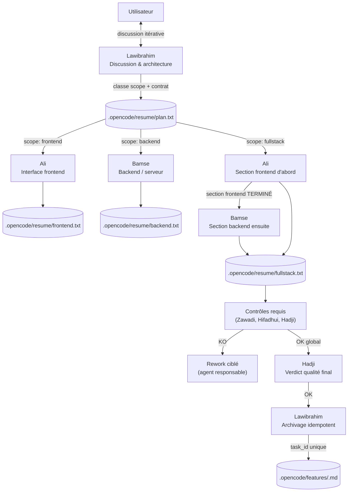

# Sayrhazi

<div align="center">

```text
╔═══════════════════════════════════════════════════╗
║                                                   ║
║     ____                   _                 _    ║
║    / ___|  __ _ _   _ _ __| |__   __ _ ____ (_)   ║
║    \___ \ / _` | | | | '__| '_ \ / _` |_  / | |   ║
║     ___) | (_| | |_| | |  | | | | (_| |/ /__| |   ║
║    |____/ \__,_|\__, |_|  |_| |_|\__,_/_____|_|   ║
║                 |___/  v0.14.0 - sayrhazi         ║
║                                                   ║
╚═══════════════════════════════════════════════════╝
```

</div>

**Sayrhazi** est un workflow multi-agents portable pour structurer le développement logiciel, orchestré via [OpenCode](https://opencode.ai). Il peut être installé dans une application, un site web, une API ou tout autre projet technique. Chaque agent a un rôle précis et cloisonné.

### Origine du nom

**Sayrhazi** (prononcé *Sayrazi*, le « h » restant muet) fusionne deux racines :
- **Sayr** (سير), terme arabe désignant le cheminement, le déroulement d'un processus.
- **Hazi**, mot comorien signifiant le travail.

## Vue d'ensemble



Tous les agents respectent les règles communes (`AGENTS.md` du projet) : lire `.opencode/sayrhazi.yaml` comme seule source de vérité, ne jamais supposer le nom du projet, se présenter avec nom + type + stack (ouverture ou demande uniquement), répondre en français avec typographie correcte, emojis proscrits dans le travail.

## Les agents

| Agent | Fichier | Rôle | Modèle | Couleur |
|---|---|---|---|---|
| **Lawibrahim** | `agent/lawibrahim.md` | Partenaire de réflexion — clarifie le besoin, classe le scope (`frontend`, `backend`, `fullstack`), déclare les contrôles requis et le contrat d'échange. N'implémente et ne review jamais. Archive les features bouclées dans `.opencode/features/`. | `muse-spark-1.3` | `#8B5CF6` |
| **Ali** | `agent/ali.md` | Interface frontend — maquettes, écrans, composants, responsive, thèmes. Écrit `frontend.txt` (scope `frontend`) ou sa section de `fullstack.txt` (scope `fullstack`, d'abord, avant Bamse). Ne touche ni à l'existant ni à la logique. | `muse-spark-1.3` (vision) | `#3B82F6` |
| **Bamse** | `agent/bamse.md` | Backend et logique serveur — implémente à partir de `plan.txt`, vérifie, écrit `backend.txt` (scope `backend`) ou sa section de `fullstack.txt` (scope `fullstack`, après Ali seulement). Seul à modifier le code existant et la logique. | `muse-spark-1.3` | `#22C55E` |
| **Hadji** | `agent/hadji.md` | Reviewer qualité — bugs, régressions, architecture, performance. Rend le verdict qualité final (`VALIDÉ` / `VALIDÉ AVEC RÉSERVES` / `CORRECTIONS NÉCESSAIRES`). **Ne couvre pas la sécurité.** | `muse-spark-1.3` | `#F59E0B` |
| **Hifadhui** | `agent/hifadhui.md` | Spécialiste sécurité — injections, auth/sessions, secrets, dépendances, contrôle d'accès. Son verdict KO bloque la clôture et l'archivage. | `muse-spark-1.3` | `#EF4444` |
| **Zawadi** | `agent/zawadi.md` | Testeuse QA visuelle et fonctionnelle — rendu réel, responsive, modes clair/sombre, parcours. Teste après Ali (frontal) et/ou après Bamse (parcours intégré) selon le plan. Ne déduit jamais un rendu du seul code. | `muse-spark-1.3` (vision) | `#14B8A6` |

Tous en `mode: primary` — on parle à un seul agent à la fois. Flux par scope : `frontend` → Lawibrahim → Ali → Zawadi (si requis) → Hadji ; `backend` → Lawibrahim → Bamse → Hifadhui (si requis) → Zawadi (si requis) → Hadji ; `fullstack` → Lawibrahim → Ali (section frontend) → Bamse (section backend, après Ali TERMINÉ) → contrôles requis → Hadji (verdict final) → archivage par Lawibrahim après OK global. Hifadhui sur les zones à risque. Les noms d'affichage sont modifiables par projet via `agents:` dans `sayrhazi.yaml` (fichiers et rôles stables).

## Les fichiers de suivi

### État courant (`.opencode/resume/`)

Chaque fichier est **remplacé** à chaque passage — il ne contient que le dernier état, pour rester rapide à lire.

| Fichier | Écrit par | Lu par |
|---|---|---|
| `plan.txt` | Lawibrahim | Bamse, Ali |
| `frontend.txt` | Ali | Hadji, Zawadi |
| `backend.txt` | Bamse | Hadji, Hifadhui, Zawadi |
| `review.txt` | Hadji | Bamse (si corrections), Zawadi |
| `security.txt` | Hifadhui | Bamse (si corrections) |
| `qa.txt` | Zawadi | Bamse (si corrections signalées) |
| `frontend.txt` | Ali | Hadji, Zawadi |
| `backend.txt` | Bamse | Hadji, Hifadhui, Zawadi |
| `fullstack.txt` | Ali (section frontend), Bamse (section backend) | Hadji, Hifadhui, Zawadi |

Chaque rapport contient : date système réelle, projet, tâche (`task_id:` stable, ex. `FEATURE-001`), auteur (`agent:`, rôle stable), horodatage (`completed_at:`, ISO 8601), résumé (`summary:`), `status:`, vérifications, problèmes classés `CRITIQUE / HAUTE / MOYENNE / FAIBLE`, limites, suite et verdict du rôle (`TERMINÉ` = achèvement, `VALIDÉ` = verdict). Aucun secret dans les rapports. Référence : `docs/reports.md`, validateur : `engine/report.py`.

### Historique (`.opencode/history/`)

Avant de remplacer son fichier `resume/`, chaque agent archive l'ancien contenu ici : `build-log.md`, `design-log.md`, `review-log.md`, `security-log.md`, `qa-log.md`, `frontend-log.md`, `backend-log.md`. `plan.txt` reste cumulatif jusqu'à l'archivage explicite d'une feature dans `.opencode/features/<nom>.md`. L'artefact `fullstack.txt` est archivé dans `history/fullstack-log.md` (une entrée cumulative par `task_id`, après OK global uniquement).

> Les fichiers `design.txt` et `build.txt` sont conservés pour la rétrocompatibilité des projets installés avant la v0.14.0 (via les aliases `ROLE_ALIASES`), mais ne figurent plus dans le tableau des rapports standards par défaut (`frontend.txt`/`backend.txt`).

## Comment ça se déroule concrètement

1. **Discussion** — avec Lawibrahim. Il classe la tâche par scope (`frontend`, `backend` ou `fullstack`), déclare les contrôles requis et le contrat d'échange dans `plan.txt` (`À IMPLÉMENTER`, `INFORMATIF`, puis `VALIDÉ` quand la décision est prise), uniquement après confirmation explicite.
2. **Implémentation** — scope `frontend` : Ali écrit `frontend.txt` (`EN COURS`, `TERMINÉ` ou `BLOQUÉ`). Scope `backend` : Bamse écrit `backend.txt`. Scope `fullstack` : Ali écrit sa section de `fullstack.txt` **d'abord**, puis Bamse écrit sa section de `fullstack.txt` uniquement quand la section frontend est `TERMINÉ`.
3. **Vérifications** — selon les contrôles déclarés dans le plan : Zawadi (QA frontend après Ali, QA intégré après Bamse si requis), Hifadhui (audit sécurité si requis), Hadji (review qualité globale).
4. **Review qualité** — Hadji lit le rapport d'implémentation (`frontend.txt`, `backend.txt` ou `fullstack.txt` selon le scope), inspecte le code, écrit `review.txt` (`VALIDÉ`, `VALIDÉ AVEC RÉSERVES` ou `CORRECTIONS NÉCESSAIRES`). Déclenchable auto via `watch-work.py`.
6. **Rework** — si un contrôle est KO, la correction revient à l'agent responsable (Ali pour le frontend, Bamse pour le backend, Lawibrahim pour le contrat d'échange). Les contrôles affectés sont rejoués.
7. **Archivage** — lorsque tous les contrôles requis sont OK et que Hadji a rendu son verdict final OK, Lawibrahim archive l'artefact complet dans `history/fullstack-log.md` (scope `fullstack`) ou dans l'historique correspondant (scopes simples). L'archivage est idempotent (clé : `task_id`).
8. **Terminé** — la tâche est clôturée et l'artefact courant peut être réinitialisé uniquement après vérification que l'archive est complète.

## Docker est-il nécessaire ?

**Non, pas par défaut.** Le fichier `.opencode/sayrhazi.yaml` est uniquement un fichier de configuration : nom, stack, commandes, exigences qualité. Un YAML ne lance aucun conteneur.

Docker devient utile uniquement si le projet applicatif l'exige (PostgreSQL, Redis, environnement reproductible...). Dans ce cas, Docker appartient au projet applicatif, pas au noyau Sayrhazi.

## Architecture

Sayrhazi est séparé du code de chaque projet :

```text
Sayrhazi/      # noyau : core, runtimes/opencode, engine, cli, tests, docs
MonProjet/     # projet : code + .opencode/ + AGENTS.md
```

Chaque projet possède sa propre copie de `.opencode/agent/` (`sayrhazi.yaml`, `workflow.yaml`, `opencode.json`, `watch-work.py`, `resume/`, `history/`, `features/`, `state/` local à ignorer par git). `.opencode/workflow.yaml` décrit le parcours déclaratif (étapes, déclencheurs, conditions) ; seule la transition `build → Hadji` est automatique, le reste est orchestré par l'humain. Les rapports et historiques ne sont jamais partagés entre projets. Les agents ne supposent jamais le nom du projet : ils lisent `.opencode/sayrhazi.yaml`.

## Installation dans un projet

Prérequis : Python ≥ 3.10, Node.js LTS.

```powershell
npm install -g sayrhazi
```

Puis, depuis n'importe quel projet :

```powershell
sayrhazi .
```

L'installation globale place le binaire `sayrhazi` (ou `sayrhazi.cmd` sous Windows) dans le `PATH` de npm. Aucun script de profil n'est à sourcer : les commandes `sayrhazi info`, `sayrhazi check`, `sayrhazi tunda`, `sayrhazi update`, `sayrhazi remove` et `sayrhazi --version` fonctionnent immédiatement.

Sans npm, depuis un clone du dépôt (`https://github.com/Lawi-Salim/sayrhazi.git`) :

```powershell
& "<clone>\runtimes\opencode\scripts\Install-Sayrhazi.ps1" -ProjectPath "."
```

Le script ne supprime ni ne remplace rapports, historiques, décisions ou configuration existants. Après installation, compléter `.opencode/sayrhazi.yaml`, renseigner les règles locales (`AGENTS.md` §4), puis vérifier avec `sayrhazi tunda`.

## Commandes

Les crochets indiquent un argument optionnel : sans argument, la commande vise le dossier courant. Toutes s'invoquent comme `sayrhazi <commande>` et ne dépendent d'aucun profil de terminal.

| Commande | Usage | Effet |
|---|---|---|
| `sayrhazi [chemin]` | installe + contrôle | Agents + watcher recopiés, config créée si absente, état préservé |
| `sayrhazi check [chemin]` | diagnostic rapide | Vérifie que Sayrhazi est initialisé dans le projet (agents, dossiers, config) |
| `sayrhazi tunda [chemin]` | diagnostic détaillé | Checklist : structure, 6 agents, 0 `A_COMPLETER`, schéma, contrats des rapports + `workflow.yaml` (signalés, jamais bloquants), version vs noyau (exit 0/1/2) |
| `sayrhazi update [chemin]` | mise à jour | Agents + watcher recopiés, migration douce + backup, version alignée, check relancé |
| `sayrhazi info [chemin]` | renseigne | Banner + versions noyau/installé, agents présents, rapports (lecture seule) |
| `sayrhazi remove [chemin] [--yes]` | retire prudemment | Simulation puis confirmation ; fichiers noyau seuls, jamais config/rapports/historique |
| `sayrhazi-tui [chemin]` | dashboard | Lance `.opencode/watch-tui.py` sur le projet le plus proche (courant par défaut) ; `--once` pour une capture unique. Binaire npm sur le PATH, indépendant du profil de terminal |
| `sayrhazi --version` | version | Affiche la version du noyau |

## Zawadi et Playwright (optionnel)

Zawadi peut piloter un vrai navigateur via un serveur MCP Playwright :

```json
{
  "$schema": "https://opencode.ai/config.json",
  "mcp": {
    "playwright": {
      "type": "local",
      "command": ["npx", "-y", "@playwright/mcp@latest"],
      "enabled": true
    }
  },
  "permission": {
    "playwright_*": "deny"
  }
}
```

Le `deny` global empêche les autres agents d'y accéder ; seuls `ali.md` (observation) et `zawadi.md` (tests) ont `playwright_*: allow`. Sans navigateur ni captures, Zawadi rend le verdict `À COMPLÉTER` au lieu d'inventer un rendu.

## Automatisation

Le cœur fonctionne manuellement ; `watch-work.py` (installé dans `.opencode/`) est un moteur piloté par `.opencode/workflow.yaml` : chaque étape `auto: true` déclenche l'agent du rôle si rapport, statut, condition et sortie le permettent (`review` toujours, `security`/`visual_qa` si requis, `rework` vers Bamse sur corrections ; Ali manuel). Pour le scope `fullstack`, Bamse ne démarre que quand la section frontend d'Ali est `TERMINÉ`. Les étapes éligibles ensemble partent en parallèle (bornées par `max_parallel_agents`), convergence journalisée, échec isolé. Les serveurs (`yarn dev`) vivent hors des agents via `services.py` (`start/stop/status/logs`) : les agents utilisent l'URL sans jamais la gérer. `tunda` affiche les agents requis par la configuration. Le reste du flux est prescrit par scope mais orchestré par l'humain. Il refuse les rapports incomplets (contrat `task_id` + `agent` + `status` + `completed_at`, voir `docs/reports.md`), empêche les doubles déclenchements et applique un timeout. `tunda` signale les rapports non conformes sans bloquer. Pas de retour auto vers Bamse, pas de boucle après review négative : les décisions restent humaines.

Limites connues : permissions en mode headless, fichiers créés hors projet (Bamse doit travailler dans le projet), sessions longues interrompues.

## Étendre le système

Pour ajouter un agent : créer `core/agents/<nom>/{agent.yaml,instructions.md,contract.yaml}` (sans nom de projet en dur), régénérer avec `python engine/renderer.py` (vérifier avec `--check`), lui donner son fichier `resume/` + journal `history/`, ne lui faire lire que le nécessaire, mettre à jour engine/cli/validateurs, docs, templates et `CHANGELOG.md`.

## Versionnement

Le noyau est versionné séparément des projets (voir `CHANGELOG.md`, tags `v0.x.y`). Après modification des agents ou templates, déployer la nouvelle copie projet par projet (`Sayrhazi .` met à jour agents et watcher sans écraser la config).
